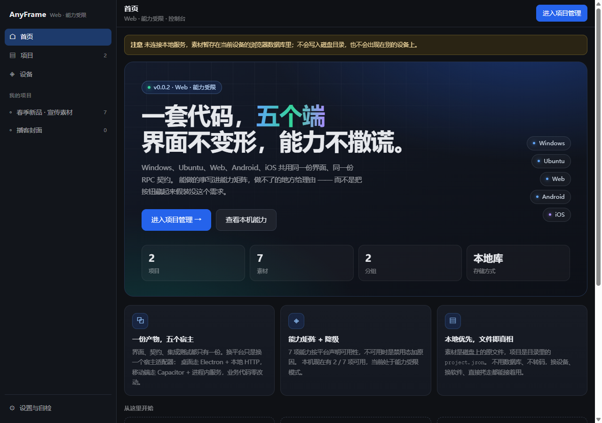
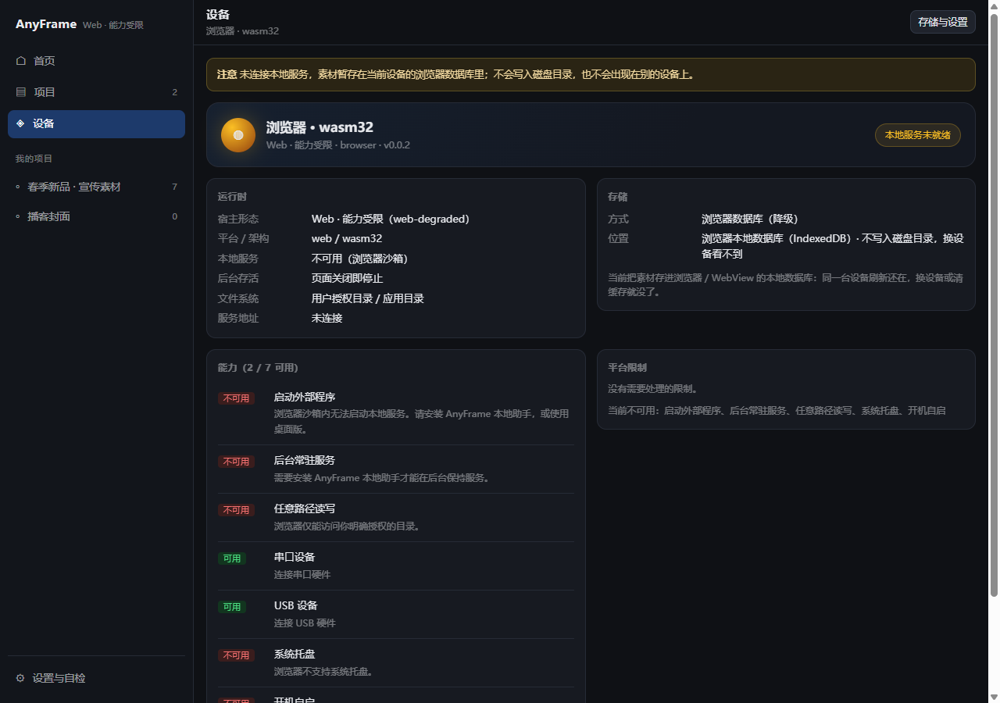

# AnyFrame

**一套代码 → Windows 桌面 / Ubuntu 桌面 / Web / Android / iOS 五端构建工程。**

这不是一个「跨平台 UI 框架」，而是一套**构建配置与能力降级方案**。
它解决的问题很具体：产品需要「启动本地服务 + 读写本地文件」，
而这两件事在五个平台上的可行性天差地别 —— 桌面端随便做，Web 端要靠本机 Agent，
Android 只能跑 App 自己进程内的服务，iOS 则被审核指南 2.5.2 永久禁止启动外部程序。

AnyFrame 的做法是把这些差异收敛到一份 TypeScript 契约和一张能力表里，
业务代码只问一句「这个功能现在能用吗」，UI 据此显示 **禁用 + 原因**，
而不是把按钮藏起来。

---

## 三十秒看懂架构

```
                    ┌──────────────────────────────────┐
                    │   packages/core  （唯一真相源）    │
                    │   契约 schema · 能力基线 · RPC 客户端 │
                    └───────────────┬──────────────────┘
                                    │
        ┌───────────────┬───────────┴────────┬────────────────┐
        │               │                    │                │
  apps/desktop     apps/agent            apps/web        apps/mobile
   Electron      本机常驻 Agent          浏览器          Capacitor 8
        │               │                    │                │
        └───────┬───────┘                    │                │
                │                            │                │
                ▼                            ▼                ▼
     POST http://127.0.0.1:<port>/rpc/<method>   ←── 四个宿主走的是同一条路
```

关键决策：**桌面端也不走 Electron IPC，而是走 HTTP。**
renderer 连的是主进程起的 `127.0.0.1` RPC 服务，和 Web 版连本机 Agent
用的是同一个客户端、同一份契约、同一套集成测试。
代价是桌面端也要开一个本地端口，用 token 鉴权 + Origin 白名单 +
Host 头校验（防 DNS rebinding）补偿。

移动端不能 `spawn`，所以「本地服务」被实现为 **App 自己进程内的回环 HTTP 服务**：
Android 用 `specialUse` 前台服务里的手写 `ServerSocket`，
iOS 需要在原生侧用 `NWListener` 实现同等接口。
换掉的只是服务提供方，前端一行都不用改。

> 为什么不用 Tauri：Rust 外壳跑不了 Node 本地服务，把 Node 打进包体积优势就没了，
> 而且 Linux 上的 WebKitGTK 版本分化会导致「同一个包在不同发行版行为不一致」。

详细的平台约束、能力矩阵与依据见 **[BUILD_MATRIX.md](BUILD_MATRIX.md)**。

---

## 目录结构

```
anyframe/
├── packages/core/            契约（zod schema）+ 能力基线 + RPC 客户端/服务端
│   └── src/
│       ├── index.ts          ← 浏览器安全的 barrel，禁止出现 node:* 依赖
│       ├── node.ts           ← Node 宿主的 barrel（startRpcServer / ServiceManager / NodeFsProvider）
│       ├── contract.ts       ← 所有 RPC 方法的入参出参 schema，单一真相源
│       ├── capabilities.ts   ← 五端能力表 + can() / reason()
│       └── runtime/
├── packages/ui/              **产品界面本身**（React，三端共用同一份源码）
│   └── src/
│       ├── model/            项目 / 分组 / 素材的纯数据模型与操作（可单测）
│       ├── data/             存储（RPC fs ↔ IndexedDB）+ 导入管线 + 缩略图
│       ├── ui/               响应式界面：侧边栏 / 底部导航 / 网格 / 查看器 / 设置
│       ├── app/              宿主会话 → 数据 → 页面的组装层
│       └── host/             五端宿主探测（能力受限时降级）
├── apps/desktop/             Electron：main + preload + renderer
├── apps/agent/               本地 Agent，Node SEA 打成单文件可执行程序
├── apps/web/                 静态站点，靠 Agent 获得完整能力
├── apps/mobile/              Capacitor 8
│   ├── src/                  前端（含 src/native/ 的插件封装）
│   ├── native/               原生工程的**补丁片段**（Kotlin / manifest / gradle / plist）
│   └── scripts/              setup-native.mjs（生成并打补丁）+ build-android/ios.mjs
├── scripts/
│   ├── check-env.mjs         环境自检（--strict / --target）
│   ├── set-version.mjs       版本号盖章（五端一致）
│   └── postinstall.mjs       装完依赖后的提醒（永不失败）
└── .github/
    ├── workflows/ci.yml      PR 门禁：类型 / 测试 / 编译，5 分钟
    ├── workflows/build.yml   五端产物流水线 + Release 发布
    └── actions/setup-pnpm/   八个构建 job 共用的 pnpm + Node 准备步骤
```

`apps/mobile/android/` 与 `apps/mobile/ios/` **不入库**（见 `.gitignore`）。
它们由 `cap add` 生成、由 `scripts/setup-native.mjs` 打补丁。
这样 Capacitor 升级时不会和我们的改动打架，也避免了几万个第三方文件进 git。

---

## 产品界面（v0.0.2）

当前版本 **v0.0.2**。打开应用先是**驾驶舱**：一句话说清「一套代码，五个端」，
四格真实数据（项目 / 素材 / 分组 / 存储方式），两个主行动 —— 进入项目管理、查看本机能力。



- **四个一级入口**：首页 / 项目 / 设备 / 设置。桌面走左侧导航，手机走底部 tab，同一组顺序；
- **设备页**把能力矩阵摆到明面：7 项能力逐条给「可用 / 不可用」与依据，
  顶部一颗状态灯区分「本地服务已连接 / 未就绪」；
- 项目页是「分组条 + 素材网格」，拖拽（桌面）或系统媒体选择器（手机）导入，原位保存不转码；
- 分组是标签而不是文件夹：同一素材可以进多个分组，删分组不会删素材；
- 没有本地服务时整体退化为 IndexedDB 存储，并在页面顶部说明数据存在哪。



功能逻辑、数据模型、交互取舍与后续扩展点见 **[docs/V1-PLAN.md](docs/V1-PLAN.md)**；
逐版本变更见 **[CHANGELOG.md](CHANGELOG.md)**。

---

## 环境准备

必需：

- **Node.js ≥ 22**（Capacitor 8 与 Vite 8 的硬要求）
- **pnpm ≥ 9.5**（`catalog:` 协议需要）
- **git**

按目标额外需要：JDK 21（Android）、Xcode 26 + CocoaPods（iOS，且只能在 macOS 上）、
rpm（Linux 桌面打包）。

先自检，别等构建到第 8 分钟才发现缺东西：

```bash
pnpm install
pnpm check-env               # 人类可读报告，列出每个端「可产出 / 不可产出」
pnpm check-env --target ios  # 只看 iOS
```

---

## 常用命令

```bash
# ── 开发 ──────────────────────────────────────────────
pnpm dev:desktop             # Electron 主进程热重启 + renderer HMR
pnpm dev:web                 # http://localhost:5174
pnpm dev:agent               # 本机 Agent，默认监听 47730
pnpm dev:mobile              # http://localhost:5175，真机可用局域网 IP 访问

# ── 编译（不打包）────────────────────────────────────
pnpm build:all               # core + 四个 app 全部编译

# ── 出产物 ────────────────────────────────────────────
pnpm dist:win                # NSIS 安装包 + 便携版
pnpm dist:linux              # deb + rpm + AppImage
pnpm dist:web                # apps/web/dist
pnpm dist:agent              # 单文件可执行程序（Node SEA）
pnpm dist:android            # AAB + APK（首次需先 setup:native）
pnpm dist:ios                # IPA（仅 macOS）

# ── 质量 ──────────────────────────────────────────────
pnpm typecheck               # pnpm -r typecheck，按拓扑序
pnpm test

# ── 版本 ──────────────────────────────────────────────
pnpm version:set 1.4.0       # 一次写进全部 6 个 package.json
pnpm version:from-tag        # 从 HEAD 的 tag 推导
```

移动端首次构建需要先生成原生工程：

```bash
pnpm build:mobile
pnpm --filter @anyframe/mobile setup:native      # 或 setup:native android
```

> ⚠️ 顺序不能反。`cap add` / `cap sync` 会把 `apps/mobile/dist` 拷进
> `android/app/src/main/assets/public`，先跑 setup 会得到一个空 assets 的工程，
> App 装上后是纯白页，而且**不报任何错**。

---

## CI / CD

两条流水线：

**`ci.yml`** —— push / PR 触发，单个 ubuntu job，目标 5 分钟内给结论。
跑类型检查、单测、五端编译，并把产物体积写进 Step Summary。

**`build.yml`** —— 打 `v*.*.*` tag 或手动触发，八个并行 job 分别产出五个端，
最后汇总到同一个 GitHub Release。之所以不能合并成一个 matrix job：
electron-builder 无法交叉打包，iOS 只能在 macOS 上打。

发布流程：

```bash
git tag v1.4.0
git push origin v1.4.0
```

tag 名就是版本号，`meta` job 会把它同时写进 package.json（electron-builder）、
`ANYFRAME_VERSION_NAME`（Android）、`MARKETING_VERSION`（iOS）和 Release 标题，
避免出现「安装包叫 1.4.0，Release 标题是 1.4.1」。

需要配置的 Secrets / Variables 清单见 [BUILD_MATRIX.md 第 5 节](BUILD_MATRIX.md#5-ci-流水线)。

---

## 已知坑索引

每一个都在代码里留了注释说明「为什么」，这里只列位置，方便按症状反查：

| 症状 | 位置 |
| --- | --- |
| 移动端所有插件调用静默失败，控制台只有 CSP 报错 | `apps/mobile/index.html` —— Capacitor 用内联 `<script>` 注入桥，`script-src` 必须含 `'unsafe-inline'` |
| 原生服务 `running: true`，但前端连不上，原生侧无日志 | 同上 —— CSP 的 `connect-src` 必须显式放行 `http://127.0.0.1:*`，`'self'` 不覆盖它 |
| App 打开是空白页或旧内容 | `apps/mobile/capacitor.config.ts` —— Capacitor CLI 8.5.3 的 `cap init` 会把 `webDir` 写成 `www`，必须显式声明 `dist` |
| Release 包能装能开，但每次插件调用都挂起，logcat 报 `Unable to find plugin` | `apps/mobile/native/android/proguard-rules.pro` —— R8 改掉了 `@CapacitorPlugin` 注解类的名字 |
| Android 前台服务 6 小时后被杀 | `apps/mobile/native/android/AndroidManifest.fragment.xml` —— Android 15+ 的 `dataSync` 有时限，必须用 `specialUse` |
| iOS 报 ATS 拦截，`NSAllowsArbitraryLoads` 一加就好 | `apps/mobile/native/ios/Info.plist.patch.xml` —— 正确解法是 `NSAllowsLocalNetworking`，前者会导致审核被拒 |
| Ubuntu Dock 上出现两个图标 | `apps/desktop/electron-builder.yml` —— `executableName` 与 `desktop.StartupWMClass` 必须一致 |
| deb 安装报「依赖 libasound2 无法满足」 | 同上 —— Ubuntu 24.04 起改名 `libasound2t64`，必须在 `ubuntu-24.04` 上构建 |
| `pnpm install` 报 `No matching version found: typescript@5.9.0` | `pnpm-workspace.yaml` —— TS 的 5.9 线从 **5.9.2** 才开始，且 `latest` 已是 Go 重写的 7.0.2 |
| 构建通过但启动就崩，报 `Cannot find module '@anyframe/core/node'` | `apps/desktop/tsup.config.ts` / `apps/agent/tsup.config.ts` —— `noExternal` 要用正则 `/^@anyframe\//`，字符串匹配不到子路径 |
| 浏览器 bundle 里混进了 `node:http` | `packages/core/src/index.ts` —— 浏览器侧只准用 `@anyframe/core`，Node 侧用 `@anyframe/core/node` |
| 改一个契约字段，某个宿主悄悄不兼容 | `packages/core/src/runtime/server.ts` —— `RpcHandlerMap` 是从方法表推导的映射类型，契约一变四个宿主同时报错 |
| 线上 Android 崩溃栈全是 `a.b.c` | `mapping.txt` 没归档。CI 里它作为独立 artifact 保留 365 天，且**不进 Release** |

---

## 当前状态

**已验证**（在 Windows x64 / Node 24 / pnpm 9.15 上真实跑通，不是「看起来对」）：

| 链路 | 结果 |
|---|---|
| `pnpm install` | ✓ 含 postinstall 的 Electron 二进制与原生依赖重建 |
| `pnpm typecheck` | ✓ 6/6 包通过 |
| `pnpm test` | ✓ 33 个单测 + 5 项 DiskStore 端到端（真实 RPC + 临时目录） |
| `pnpm build:all` | ✓ core + ui + 四个 app 全部编译 |
| 界面端到端 | ✓ 真实 Electron 渲染进程跑通「新建项目 → 建分组 → 改名 → 刷新后仍在 → 删除项目」（18/18 断言） |
| 响应式布局 | ✓ 同一份产物在 1280×900 / 820×1000 / 390×844 三种窗口下渲染正确（截图见 docs/images） |
| 首页 / 设备页（v0.0.2） | ✓ 驾驶舱与能力页在桌面 / 手机两种尺寸下渲染正确，版本号由构建期注入 |
| `pnpm dist:agent` | ✓ 88.3 MB 单文件 SEA 可执行；`--help` 正常 |
| Agent RPC 实测 | ✓ capabilities / fs / service / 鉴权 / 路径穿越拦截；base64 二进制往返逐字节一致 |
| `pnpm dist:win` | ✓ NSIS x64 + arm64 + 双架构合并包 + portable + blockmap + latest.yml |
| 打包产物实跑 | ✓ `AnyFrame.exe --enable-logging`：preload 桥 → RPC → 能力矩阵渲染，托盘图标加载，内嵌图标正确 |

**未验证**（受本机环境限制，不是配置问题）：

- **Ubuntu 桌面**：electron-builder 不能跨平台构建，deb / rpm / AppImage 必须在 Linux 上产出。配置已按 electron-builder 26.18.0 的 schema 逐项核对，但没在真机上打过包。
- **Android**：本机是 JDK 17 且无 Android SDK（Capacitor 8 要 JDK 21）。`pnpm check-env --target android` 会如实报这两项。
- **iOS**：只能在 macOS 上构建。
- **Web 部署**：静态产物已构建，未实际推到托管平台。

**网络提示**：electron 与 electron-builder 的二进制从 GitHub Releases 下载。
若你的网络到不了 GitHub（典型表现：打包十几分钟后一句裸的
`connect ETIMEDOUT`），设这两个环境变量后重试，或取消 `.npmrc` 里对应两行的注释：

```bash
export ELECTRON_MIRROR=https://npmmirror.com/mirrors/electron/
export ELECTRON_BUILDER_BINARIES_MIRROR=https://npmmirror.com/mirrors/electron-builder-binaries/
```

第一次跑起来的建议顺序：

```bash
pnpm install                 # 先确认依赖能装
pnpm check-env               # 看本机缺哪几端的工具链
pnpm typecheck               # 再确认类型通得过
pnpm build:all               # 然后确认五个端都编译得出来
pnpm dist:win                # 最后挑一个你当前平台能打的端，验证打包链路
```

任何一步失败，先跑 `pnpm check-env`，它会把「缺什么工具、该装什么版本、
在什么位置」直接说出来。`--strict` 只在真缺必需项时返回 1，提示项不会。

---

## 下一步（尚未实现）

- **移动端原生 `fs.*`**：`LocalHttpService.kt` 目前只实现 `capabilities.get`，
  所以 Android / iOS 上的素材暂存在 IndexedDB。补上 `fs.read/write/list/remove`
  （可直接复用 `apps/mobile/src/native/fs.ts` 的 CapacitorFsProvider 语义）之后，
  界面无需改动就会自动改用应用私有目录里的真文件。
- **iOS 原生本地服务**：`native/ios/` 只有配置补丁，没有 Swift 实现。
  需要按 `LocalHttpService.kt` 的同等语义写一个 `NWListener`，
  参考路径见 [apps/mobile/native/README.md](apps/mobile/native/README.md)。
- **硬件层**：能力表已经声明了 serial / usb / hid / ble 的支持情况，
  但没有任何一个的实际实现。按 BUILD_MATRIX 的结论，优先做 BLE。
- **自动更新**：electron-builder 的 `publish: github` 与 `latest.yml` 已就位，
  但 renderer 里还没接 `electron-updater` —— 目前只有更新元数据在产出，
  客户端并不会去检查。
- **测试**：`packages/ui` 已有 33 个单测 + 5 项 DiskStore 端到端；
  「契约 → 四个宿主」的集成测试、Agent 的端到端冒烟（起进程 → 握手 → fs/service → 优雅退出）
  仍是空缺，后者值得固化成 CI 步骤。
- **移动端返回键**：Android 侧尚未接管返回键，项目内按返回会直接退出应用。

