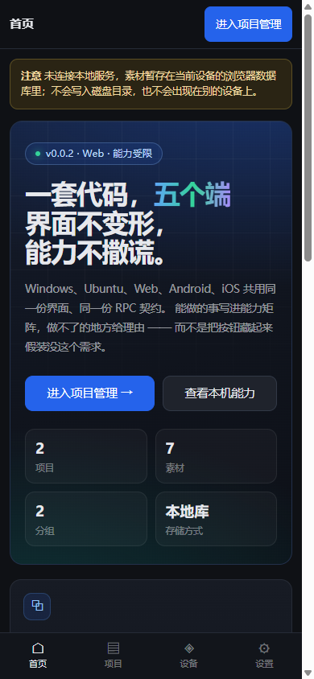
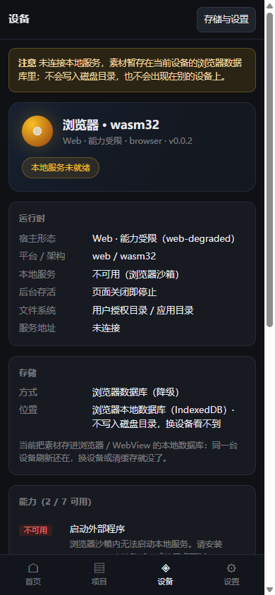
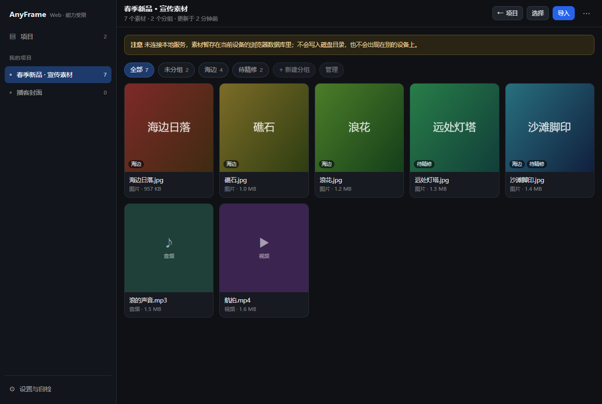
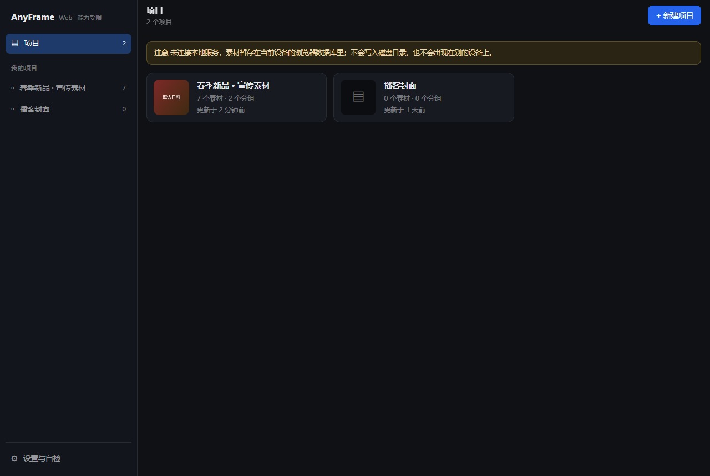
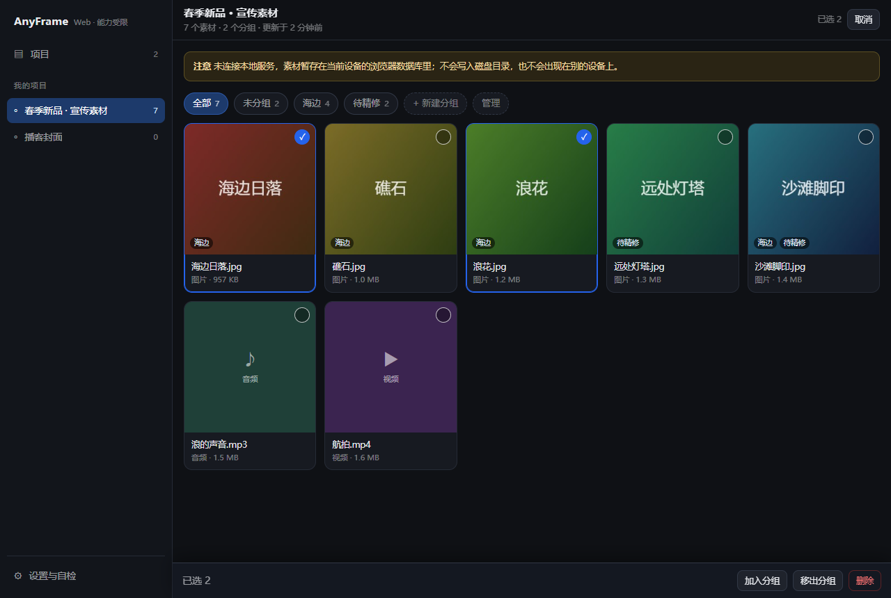
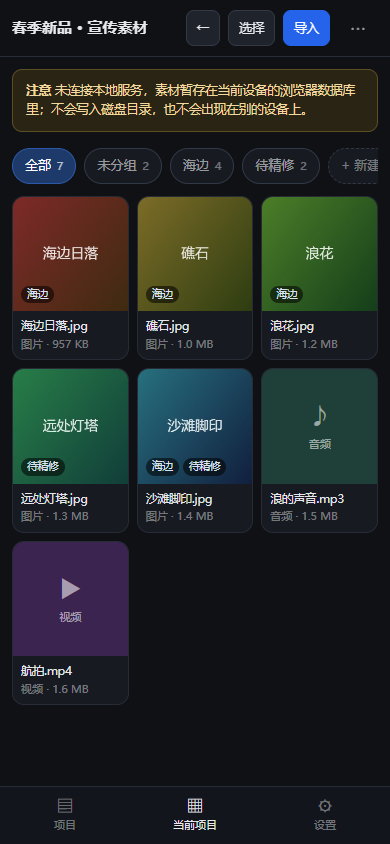
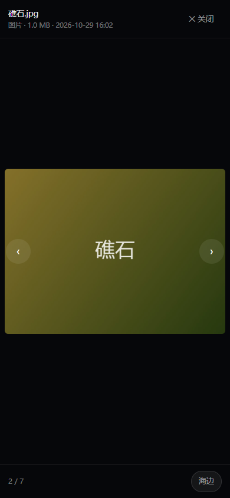
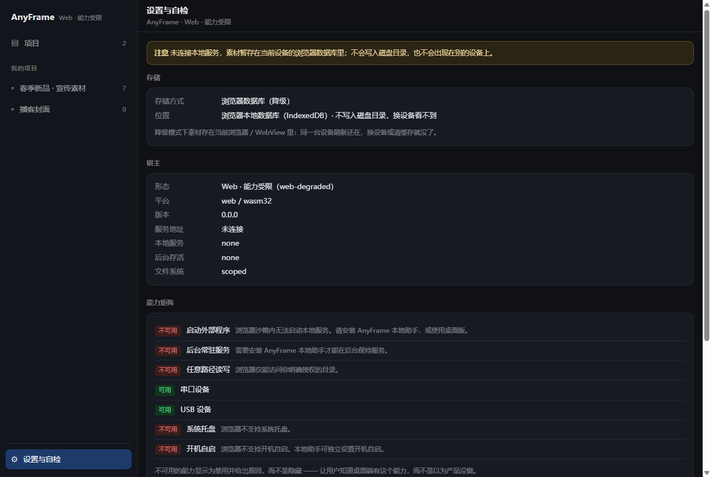
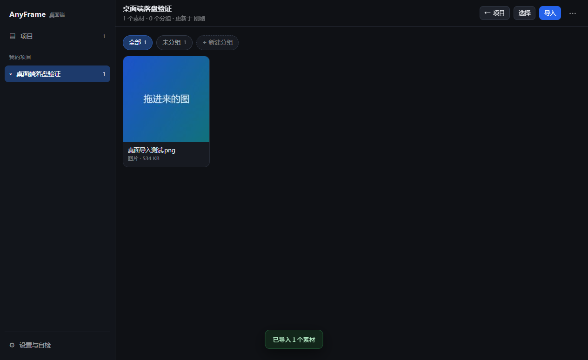

# AnyFrame v1 · 项目 / 分组 / 素材

> 这一版只做一件事：**把「项目 → 导入素材 → 编组 → 查看」这条主线跑通**。
> 跨端同步、编辑、导出、协作都不做，但每一条都留了明确的插入点（见第 7 节）。

---

## 1. 为什么先做这条线

产品要成为「按自己的需求组织多媒体资源」的工作台，最容易被做错的是**顺序**：
先做花哨的查看器、先做云端同步、先做插件体系，结果数据模型没定住，
第二次改需求就得迁移数据。

所以第一版先钉死三层结构 —— **项目 / 分组 / 素材** —— 并保证：

- 素材是**文件**，不是数据库里的二进制；卸载应用、换设备、用别的软件打开都还在；
- 分组是**元数据**，不是文件夹；同一素材可以同时出现在多个分组里；
- 删除分组**永远不删素材**，删除项目才是真正的删除（并且要二次确认）。

这三条决定了后面所有功能能不能安全地长上去。

---

## 2. 信息架构

```
首页 Home（驾驶舱）              ← 默认入口：产品说明 + 数据概览 + 两个跳转
 ├── 进入项目管理 → 项目 Projects
 │    └── 项目详情 Project
 │         ├── 分组 Groups   （0..n）  ← 多对多，仅元数据
 │         ├── 素材 Assets   （0..n）  ← 真实文件，落在磁盘
 │         └── 查看器 Viewer           ← 全屏预览，不离开项目
 └── 查看本机能力 → 设备 Device      ← 宿主 / 平台 / 7 项能力逐项可用性
设置 Settings                     ← 存储 / 版本 / 关于
```

四个一级入口：**首页 / 项目 / 设备 / 设置**，桌面在左侧导航、手机在底部 tab，同一组顺序。
首页是「产品自我说明」，不自作主张把人丢进空列表；设备页是能力矩阵的一级入口，
因为「跨端可降级」正是这个产品的卖点，藏在设置第四屏等于没做。

项目内最多一层返回就回到项目列表。
桌面端左侧导航还直接列出每个项目（省掉一次「先进列表再点进去」）。

| 端 | 导航形态 | 素材区 | 导入方式 |
| --- | --- | --- | --- |
| 桌面（≥900px） | 左侧固定导航 + 顶部工具栏 | 自适应网格 4–6 列 | 拖拽到窗口任意位置 / 文件选择框 |
| 平板（600–899px） | 顶部工具栏 + 底部 tab | 3–4 列 | 文件选择框 |
| 手机（<600px） | 底部 tab + 项目内顶部返回 | 2–3 列 | 系统媒体选择器（`<input type=file accept="image/*,video/*,audio/*">`） |

> 手机端不自己写「媒体库」页面：WebView 的 file input 在 Android 上唤起的是
> 系统照片/文件选择器，在 iOS 上是「照片图库 → 选择」。多写一层只会多一层权限与适配。
> 需要「一次选多个」时加 `multiple` 即可，两端都成立。

---

## 3. 数据模型

存储根（相对宿主的数据目录，**不写绝对路径**，这是五端共用同一份代码的前提）：

```
AnyFrame/
└── projects/
    └── <projectId>/
        ├── project.json          ← 唯一索引：分组 + 素材元数据
        ├── media/<assetId>.<ext> ← 原始文件，只写一次
        └── thumbs/<assetId>.jpg  ← 320px 缩略图（仅图片，可选）
```

相对路径在两端是这样落地的：

- 桌面 / Web（Node 宿主）：相对路径以宿主的 `dataRoot` 为基准 → `~/AnyFrame/...`；
- Android / iOS（Capacitor）：无前缀相对路径落到 `Directory.Data` → 应用私有目录，卸载即清理。

> ⚠️ **当前实现状态**：移动端原生侧的内嵌服务目前只实现了 `capabilities.get`，
> `fs.*` 还没有落地，所以 Android / iOS 上会**自动降级到 IndexedDB**（见第 6 节）。
> 好消息是这不需要改界面：等 Kotlin 侧把 `fs.*` 补上，同一份代码会自动改用真文件。

前端只拼相对路径，**不知道也不关心**自己跑在哪一端。

```ts
type MediaKind = 'image' | 'video' | 'audio' | 'other'

interface Project {
  schemaVersion: 1
  id: string
  name: string
  description: string
  createdAt: number
  updatedAt: number
  groups: Group[]     // { id, name, createdAt }
  assets: Asset[]     // 见下
}

interface Asset {
  id: string
  name: string        // 用户看到的原始文件名
  kind: MediaKind
  mime: string
  size: number
  addedAt: number
  file: string        // 'projects/<pid>/media/<aid>.<ext>'
  thumb?: string      // 'projects/<pid>/thumbs/<aid>.jpg'
  groupIds: string[]  // 多对多；空数组 = 未分组
}
```

为什么 `project.json` 是**单文件全量**而不是按素材分文件：

- 一个项目通常几十到几百个素材，JSON 在 1MB 以内，一次读写比 N 次 RPC 快；
- 原子写（`atomic: true`）保证不会读到半个文件；
- 代价是并发写会互相覆盖 —— 单用户单窗口场景可以接受，**未来多窗口需要加锁**，
  这是第 7 节里唯一被刻意推迟的架构问题。

「未分组」不是一个真实分组，而是 `groupIds.length === 0` 的视图。
这样移出分组不需要创建任何记录，也不会出现「删不掉的内置分组」。

---

## 4. 核心流程

### 4.1 新建项目

首页 → 新建 → 输入名称（默认「未命名项目 N」）→ 立刻写入 `project.json` → 进入项目页。
**先落盘再进页面**：如果写失败，用户停在原地看到错误，而不是进到一个不存在的项目里。

### 4.2 导入素材

1. 触发：桌面拖拽 / 任意端点击「导入」（手机即系统媒体选择器）。
2. 校验：单文件 ≤ **16MB**（`fs.write` 的请求体上限 32MB，base64 后放大约 1.33 倍，
   16MB 是能留出余量的最大整数档）；超出直接跳过并**列名**告诉用户，不静默丢弃。
3. 落盘：先写 `media/`（原子写），图片再生成 320px 缩略图写 `thumbs/`。
4. 记账：素材元数据追加进 `project.json`，**最后**写索引。
   顺序反过来的话，写盘失败会留下一条指向不存在文件的记录。
5. 进度：逐个处理并显示「3 / 12 · 文件名」，不并发 —— 移动端并发读大文件会 OOM。

类型识别按 MIME 优先、扩展名兜底；两者都识别不了的存为 `other`，
仍然入库、仍然可下载，只是查看器显示「暂不支持预览」。

### 4.3 编组

- 「全选 / 取消全选」→「加入分组」→ 选一个已有分组或现场新建 → 批量写入 `groupIds`。
- 同一素材加入同一分组两次是幂等的（用 Set 语义去重）。
- 移出分组后素材仍在「全部」里；删除分组时把该 id 从所有素材上摘掉，素材不动。
- 分组顺序按创建时间，第一版不提供手动排序（拖拽排序属于编辑功能，见第 7 节）。

### 4.4 查看

- 点素材 → 全屏查看器：图片 fit-contain、视频/音频用原生控件、其他类型给下载/信息兜底。
- 查看器内可左右切换（桌面方向键与按钮，手机按钮），Esc 关闭。
- 图片走缩略图先出、原图再换（有缩略图时），避免大图白屏。

### 4.5 删除

| 操作 | 影响 | 确认 |
| --- | --- | --- |
| 删除素材 | 删 `media/` + `thumbs/` 文件 + 索引条目 | 二次确认（列出数量） |
| 删除分组 | 只摘 `groupIds`，素材保留 | 说明「素材不会被删除」 |
| 删除项目 | 递归删除整个项目目录 | 二次确认，需输入项目名 |

---

## 5. 界面（v1 交付的页面与状态）

### 首页 · 驾驶舱


- Hero：一句话说清「一套代码，五个端」，右侧列出五个宿主；两个主行动：项目管理 / 设备能力。
- 数据条：项目 / 素材 / 分组 / 存储方式，四个数字，不加图表。
- 三张特性卡：一份产物五个宿主、能力矩阵 + 降级、本地优先文件即真相。
- 三步流程 + 最近项目（有数据时才出现），避免新用户面对空页面。

| 手机端首页 | 手机端设备页 |
| --- | --- |
|  |  |

### 设备页 · 这台机器能做什么


- 顶部状态：平台 / 架构 / 宿主 / 版本，一颗灯区分「本地服务已连接 / 未就绪」。
- 运行时：本地服务等级、后台存活、文件系统，都用中文解释而不是裸枚举值。
- 能力：7 项逐条给「可用 / 不可用」，可用的写它能干什么，不可用的写依据。
- 存储位置与平台限制并排，排查问题时一屏能看到。

### 项目列表



| 桌面端项目列表 | 选择态与批量操作 |
| --- | --- |
|  |  |

| 手机端项目页 | 手机端查看器 | 设置 |
| --- | --- | --- |
|  |  |  |

> 截图来自真实渲染（Electron 以桌面 / 手机两种窗口尺寸加载同一份产物），
> 数据是脚本写进 IndexedDB 的样例项目，不是设计稿。

- 卡片：封面（首个图片素材的缩略图，没有则占位）、名称、`N 个素材 · M 个分组`、更新时间。
- 空状态：一句话说清「项目是什么、为什么要先建项目」，主按钮「新建项目」。
- 大屏卡片更大、列更多；手机单列，卡片横向布局。

### 项目页


- 顶部：返回、项目名（可改）、`选择`、`导入`、`···`（重命名 / 删除项目）。
- 分组条：`全部` / `未分组` / 各分组，横向可滚动；末尾 `+ 新建分组`、`管理分组`。
- 网格：缩略图 + 文件名 + 时长/尺寸（有则显示）。视频/音频没有缩略图时用类型色块。
- 选择态：底部浮出批量操作条（已选 N / 加入分组 / 移出分组 / 删除 / 取消）。
- 拖拽态：整个内容区变成虚线投放区，提示「松开导入到「项目名」」。
- 空状态区分两种：项目里没有素材 vs 当前分组里没有素材（后者提示「去全部里看看」）。

### 设置

只剩三件事：存储（方式 / 位置 / 宿主 / 地址）、诊断入口（跳设备页）、关于这一版。
能力矩阵与平台限制已经搬到设备页 —— 之前挤在一起，想确认「能不能写磁盘」要滚三屏设置。
**自检不再占首页** —— 首页是产品，自检是诊断。

### 状态与失败

- 没有本地服务（Web 无 Agent / 移动端内嵌服务未就绪）时**不空转**：
  退化为浏览器 IndexedDB 存储，页面顶部一条横幅说明「本次数据存在本机浏览器，
  不会出现在桌面端」，并且在设置里给出修复路径（装 Agent / 重启服务）。
- 所有写操作失败都会回滚内存状态并弹错，不出现「界面显示成功、磁盘没写」。
- 导入是逐文件事务：单个失败只跳过该文件，其余继续。

---

## 6. 五端差异与降级

| 端 | 存储 | 导入 | 已知限制 |
| --- | --- | --- | --- |
| Windows / Ubuntu 桌面 | `~/AnyFrame`（Node fs，原子写） | 拖拽 + 选择框 | 无 |
| Web + 本地 Agent | 同桌面（Agent 的 `dataRoot`） | 拖拽 + 选择框 | 需要 Agent 在跑 |
| Web 无 Agent | IndexedDB | 选择框 | 数据不跨设备、不进 `~/AnyFrame` |
| Android | **v1 为 IndexedDB**（原生 `fs.*` 未实现） | 系统媒体选择器 | 数据在应用数据库里，卸载即清 |
| iOS | **v1 为 IndexedDB** | 系统照片选择器 | 同上；后台不保活 |

16MB 上限、`other` 类型不可预览、单窗口写，是 v1 明确的取舍，不是遗漏。

---

## 7. 刻意不做（以及它们该从哪儿接进来）

| 不做 | 插入点 |
| --- | --- |
| 跨端同步 / 云盘 | 存储层是 `MediaStore` 接口，加一个 `RemoteStore` 即可；`project.json` 已带 `schemaVersion` |
| 素材编辑（裁剪/转码） | 导入管线在 `data/importer.ts`，加一步后处理即可 |
| 手动排序、拖拽换组 | `Group` 加 `order` 字段；`Asset` 加 `order`。现在不写，避免迁移 |
| 多窗口同时写 | 需要给 `project.json` 加文件锁或改成 append-only 日志，是唯一已知的架构债 |
| 全文搜索 / 标签 | 索引就在 `project.json`，加 `tags: string[]` 与前端过滤即可 |
| 分享 / 导出 | 项目目录本身就是产物，导出 = 打包这个目录 |
| 撤销 | 所有写操作都经过 `saveProject()`，在这里记录上一个快照即可 |

---

## 8. 验收（v1 完成的标准）

1. 桌面端：新建项目 → 拖 5 个文件进去 → 建两个分组 → 一个素材进两个组 → 查看大图 →
   删分组确认素材还在 → 关掉应用重开，数据还在。
2. 手机端：新建项目 → 从相册选图 → 分组 → 查看 → 杀进程重开，数据还在。
3. Web 无 Agent：能建项目、能导入、刷新后还在，横幅明确提示存储位置；
   装上 Agent 刷新后看到的是 `~/AnyFrame` 里的数据。
4. 三端 `pnpm typecheck` / `pnpm build:all` 全绿。
5. 单元测试覆盖：分组增删的幂等性、删组不删素材、素材筛选、类型识别。

---

## 9. 代码落点

```
packages/ui/src/
├── model/            纯数据模型与纯函数（无 React、无 IO，可单测）
│   ├── types.ts
│   ├── media.ts      类型识别、扩展名、大小格式化
│   └── operations.ts 项目/分组/素材的不可变操作
├── data/             存储与导入（IO 全在这一层）
│   ├── store.ts      MediaStore 接口 + 路径约定
│   ├── disk-store.ts RPC fs 实现（桌面 / Agent / 移动内嵌服务）
│   ├── browser-store.ts IndexedDB 实现（无服务时降级）
│   ├── thumbnail.ts  canvas 缩略图
│   └── importer.ts   逐文件导入 + 进度 + 上限
├── ui/               界面（只依赖 model 与 store）
│   ├── theme.ts      全部 CSS（一份，含响应式断点）
│   ├── components.tsx
│   ├── AppShell.tsx  侧边栏 / 底部导航（首页 / 项目 / 设备 / 设置）
│   └── pages/        Home / Device / Projects / Project / Settings + Viewer
├── app/               组装层
│   ├── AnyFrameApp.tsx 宿主 → store → 页面
│   ├── useLibrary.ts   数据层与 React 的接缝（乐观更新 + 失败回滚）
│   └── useMediaUrl.ts  存储 key → 可显示的 URL
├── version.ts         版本号展示口径（构建期注入 __ANYFRAME_VERSION__）
└── vitest.config.ts   单测 / 端到端测试配置（正则 alias 区分 core 与 core/node）
```

**为什么 UI 放在 `packages/ui` 而不是各自的 `apps/*/src`**：这套界面要在五端长得一样，
三份拷贝必然分叉。`apps/*` 只负责「探测宿主 → 把 HostSession 交给 UI」，
这条边界和现有 `packages/ui/src/host/` 的设计一致。

三个入口文件（`apps/desktop/src/renderer/main.tsx`、`apps/web/src/main.tsx`、
`apps/mobile/src/main.tsx`）现在各自只有二三十行：探测宿主 → 拼一个 `HostSession` →
`<AnyFrameApp host={…} />`。它们不再包含任何页面结构。

---

## 10. 实现状态

**v0.0.2（当前）新增**

- [x] 首页驾驶舱：Hero + 四格数据 + 三张特性卡 + 三步流程 + 最近项目，两个主行动（项目管理 / 设备）
- [x] 设备页：宿主 / 平台 / 服务等级 / 存储位置 + 7 项能力逐条「可用 / 不可用 + 原因」
- [x] 导航扩为四项（首页 / 项目 / 设备 / 设置），桌面侧栏与手机底部 tab 同一组
- [x] 版本号构建期注入：Web 端不再显示 `v0.0.0`，与 `package.json` 一致
- [x] 修复：查看器背景透出下层内容、CSP 里非法的 `http://[::1]:*`、手机端顶栏过挤

**v0.0.1 已完成**

- [x] 三层数据模型 + 不可变操作（`model/`），33 个单测覆盖分组幂等、删组不删素材、筛选、类型识别
- [x] 磁盘存储（RPC `fs.*`）与 IndexedDB 降级，含「探一次再决定」的自动降级
- [x] 导入管线：拖拽 / 系统选择器、16MB 上限、按文件跳过并报名字、缩略图、失败回滚
- [x] 桌面侧边栏 + 素材网格、手机底部导航 + 分组条、全屏查看器
- [x] 端到端验证：真实 Electron 渲染进程里跑通
      「新建项目 → 建分组 → 改名 → 返回列表 → 刷新后仍在 → 删除项目」（18/18 断言通过），
      以及针对真实 RPC + 临时目录的 DiskStore 落盘测试（5 项）
- [x] 桌面端真跑：拉起未打包的桌面应用，通过 UI 建项目 → `~/AnyFrame/projects/<id>/project.json` 落盘；
      再拖一个 900×600 的图进去，`media/*.png` 与 `thumbs/*.jpg` 同时出现在磁盘上



> 这张图不是样例数据：窗口里跑的是真的 Electron 主进程，素材是真的从 drop 事件
> 写进磁盘、再从磁盘读回来渲染的。


尚未验证 / 已知缺口：

- Android / iOS 真机：原生 `fs.*` 未实现，走 IndexedDB 降级；移动端返回键未接管（退出而非返回）
- 桌面拖拽只在 Electron / 桌面浏览器上有意义，手机不触发
- 单窗口写：同时开两个窗口改同一个项目会互相覆盖（见第 7 节）

怎么自己验：

```bash
pnpm install
pnpm typecheck            # 6 个包全绿
pnpm test                 # 33 个单测 + 5 项 DiskStore 端到端
pnpm build:all            # core / ui / 四个 app 全部编译

pnpm dev:desktop          # 桌面端（数据在 ~/AnyFrame）
pnpm dev:web              # 浏览器（无 Agent 时自动降级并提示）
pnpm dev:mobile           # 手机尺寸的浏览器预览；真机用局域网 IP
```


